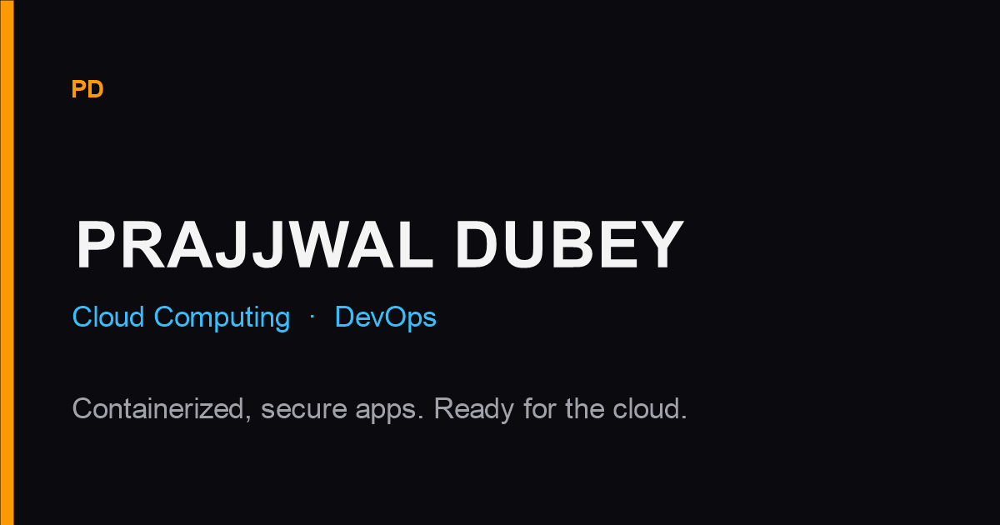

# Prajjwal Dubey

Personal portfolio for a Computer Science undergraduate targeting a Cloud Computing / DevOps internship. Dark, terminal-leaning, and built as a static site so it can sit on Amazon S3 behind CloudFront.



Replace `public/og.png` with a real screenshot of the site when you have one. Social previews use that file.

## Tech stack

- Next.js 14 (App Router) with `output: 'export'`
- TypeScript, Tailwind CSS
- Framer Motion
- lucide-react and react-icons
- next/font: Inter, JetBrains Mono, Space Grotesk

## Edit the content

All copy, links, and placeholders live in [`src/data/portfolio.ts`](src/data/portfolio.ts).

Replace these before you share the site:

| Field | Current placeholder |
| --- | --- |
| `siteUrl` | `https://example.com` |
| `person.email` | `[you@email.com]` |
| `person.phone` | `[Phone]` |
| `person.city` | `[City]` |
| `person.linkedin` | `[https://www.linkedin.com/in/YOUR_HANDLE]` |
| `education.degree` | `[Degree]` |
| `education.college` | `[College Name]` |
| `education.location` | `[City, Country]` |
| `education.graduation` | `[Expected Graduation]` |
| `certification.name` | `[AWS Certified Cloud Practitioner]` |
| `contact.formEndpoint` | `https://formspree.io/f/YOUR_FORM_ID` |

Bracketed values render as dashed slots. When you remove the brackets, they render as normal text.

Drop your resume at `public/resume.pdf` (a one-line placeholder is there now). Screenshot slots are the empty `src` strings under `project.screenshots`. Point them at files in `public/`, for example `src: "/screenshots/summary.png"`.

The contact form validates in the browser. Until `formEndpoint` is a real Formspree URL, submit opens a `mailto:` draft. The architecture diagram is labeled **Reference AWS Deployment Architecture** and does not claim a live AWS deploy.

## Run locally

```bash
npm install
npm run dev
```

Open [http://localhost:3000](http://localhost:3000).

```bash
npm run lint
npm run typecheck
npm run build
npm start
```

`npm run build` writes the static site to `out/`. `npm start` serves that folder. `next start` is not used, because this project is a static export.

### Docker preview

```bash
docker build -t prajjwal-portfolio .
docker run --rm -p 8080:80 prajjwal-portfolio
```

Open [http://localhost:8080](http://localhost:8080). The image is a local preview of `out/`. Production hosting is S3 + CloudFront.

### Keyboard

- `` ` `` or `Ctrl/Cmd+K` opens the command palette (`about`, `skills`, `project`, `contact`, `resume`, …)
- Theme choice is stored in `localStorage` under `pd-theme`
- Animations back off when `prefers-reduced-motion` is set

## Deploy on AWS

The GitHub Action in [`.github/workflows/deploy.yml`](.github/workflows/deploy.yml) assumes an IAM role with OIDC. It does not use long-lived access keys.

Set `siteUrl` in `portfolio.ts` to your CloudFront domain (or custom domain) before the first production build so canonical URLs and Open Graph tags are correct.

### 1. S3 bucket

1. Create a bucket in the region you want for the objects. Block all public access. Do not enable static website hosting. CloudFront will read the bucket through Origin Access Control.
2. Leave the bucket private. You will add a bucket policy after the distribution exists.

### 2. TLS certificate

1. Open ACM in **us-east-1**. CloudFront only accepts certificates from that region.
2. Request a public certificate for your domain (and `www` if you want it).
3. Validate with the DNS records ACM gives you.

### 3. CloudFront distribution

1. Create a distribution.
2. Origin: the S3 bucket REST endpoint (`bucket.s3.region.amazonaws.com`), not the website endpoint.
3. Origin access: Origin Access Control (OAC). Let the console create the control, then copy the bucket policy it suggests. It should look like this, with your account, bucket, and distribution filled in:

```json
{
  "Version": "2012-10-17",
  "Statement": [
    {
      "Sid": "AllowCloudFrontRead",
      "Effect": "Allow",
      "Principal": { "Service": "cloudfront.amazonaws.com" },
      "Action": "s3:GetObject",
      "Resource": "arn:aws:s3:::YOUR_BUCKET/*",
      "Condition": {
        "StringEquals": {
          "AWS:SourceArn": "arn:aws:cloudfront::ACCOUNT_ID:distribution/DISTRIBUTION_ID"
        }
      }
    }
  ]
}
```

4. Attach that policy to the bucket.
5. Default root object: `index.html`.
6. Alternate domain name: your domain. Attach the us-east-1 ACM certificate.
7. Custom error response (optional): map 403 and 404 to `/404.html` with response code 404.
8. Add a response headers policy with `X-Content-Type-Options: nosniff`, `Referrer-Policy: strict-origin-when-cross-origin`, and `X-Frame-Options: DENY`. Skip a strict Content-Security-Policy until you test it. Next.js ships inline hydration scripts, and a tight CSP will blank the page.

### 4. DNS

Point the domain at the distribution with an Alias/ANAME record (Route 53 alias, or the equivalent at your DNS host).

### 5. GitHub OIDC role

1. In IAM, add an identity provider if you do not already have one:
   - Provider URL: `https://token.actions.githubusercontent.com`
   - Audience: `sts.amazonaws.com`
2. Create a role trusted by that provider. Trust policy:

```json
{
  "Version": "2012-10-17",
  "Statement": [
    {
      "Effect": "Allow",
      "Principal": {
        "Federated": "arn:aws:iam::ACCOUNT_ID:oidc-provider/token.actions.githubusercontent.com"
      },
      "Action": "sts:AssumeRoleWithWebIdentity",
      "Condition": {
        "StringEquals": {
          "token.actions.githubusercontent.com:aud": "sts.amazonaws.com"
        },
        "StringLike": {
          "token.actions.githubusercontent.com:sub": "repo:YOUR_GITHUB_USER/YOUR_REPO:ref:refs/heads/main"
        }
      }
    }
  ]
}
```

3. Attach this permissions policy. It can list and write only your bucket, and invalidate only your distribution.

```json
{
  "Version": "2012-10-17",
  "Statement": [
    {
      "Sid": "ListBucket",
      "Effect": "Allow",
      "Action": ["s3:ListBucket"],
      "Resource": "arn:aws:s3:::YOUR_BUCKET"
    },
    {
      "Sid": "WriteObjects",
      "Effect": "Allow",
      "Action": ["s3:GetObject", "s3:PutObject", "s3:DeleteObject"],
      "Resource": "arn:aws:s3:::YOUR_BUCKET/*"
    },
    {
      "Sid": "InvalidateCloudFront",
      "Effect": "Allow",
      "Action": "cloudfront:CreateInvalidation",
      "Resource": "arn:aws:cloudfront::ACCOUNT_ID:distribution/DISTRIBUTION_ID"
    }
  ]
}
```

### 6. GitHub configuration

In the repository settings:

| Name | Kind | Example |
| --- | --- | --- |
| `AWS_ROLE_ARN` | Secret | `arn:aws:iam::123456789012:role/github-portfolio-deploy` |
| `AWS_REGION` | Variable | the bucket region, such as `ap-south-1` |
| `S3_BUCKET` | Variable | `your-portfolio-bucket` |
| `CLOUDFRONT_DISTRIBUTION_ID` | Variable | `E1234567890ABC` |

Push to `main`. The workflow installs, lints, typechecks, builds `out/`, syncs it to the bucket, and invalidates `/*`.

## Project map

- `src/data/portfolio.ts` — content
- `src/components/sections/` — page sections
- `src/components/` — chrome (nav, theme, command palette)
- `src/hooks/` — scroll, typewriter, counters
- `src/types/portfolio.ts` — the content contract
